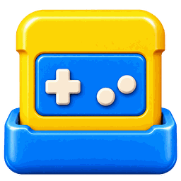
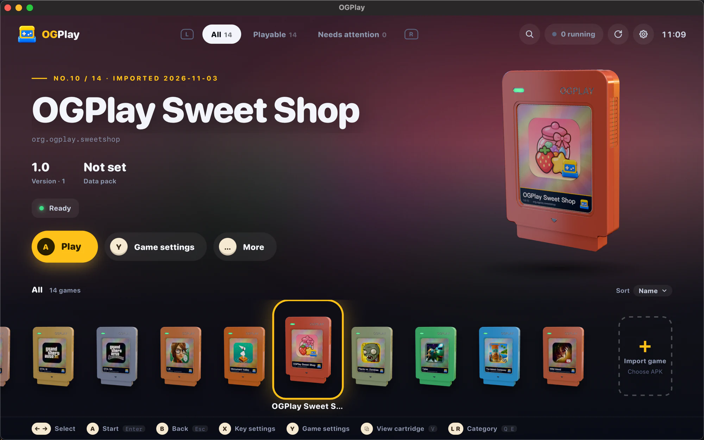
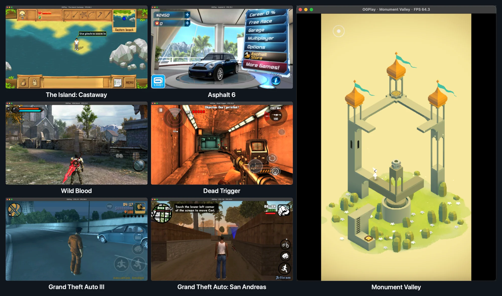
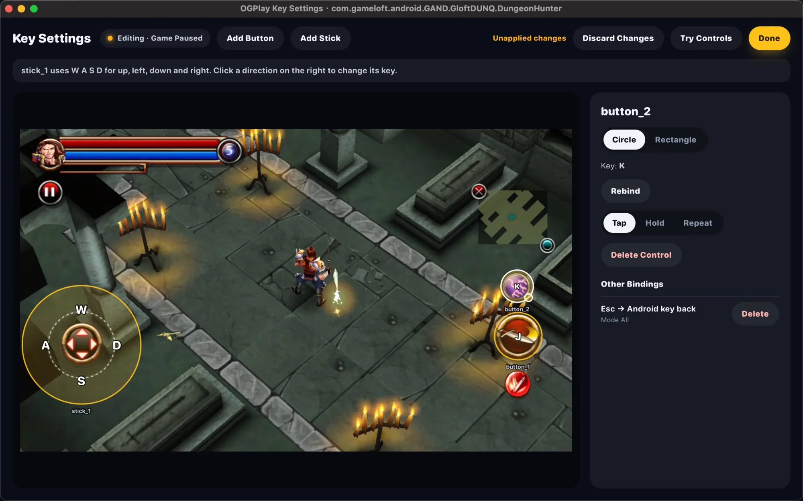
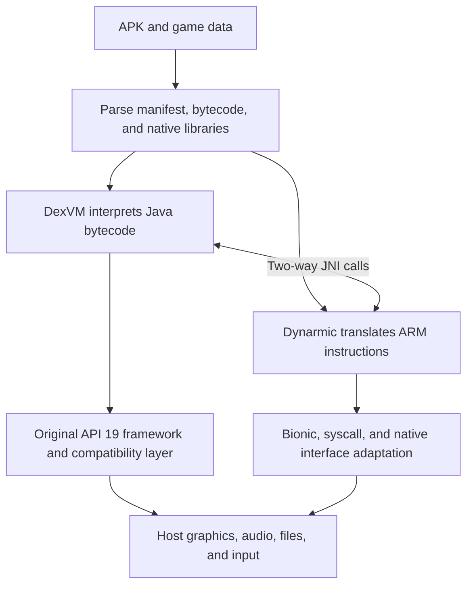

# OGPlay

**A cross-platform compatibility layer for classic Android games**

Bring classic Android games back to modern devices without an Android system image

[简体中文](README.md) | English

[Screenshots](#screenshots) · [Getting Started](#getting-started) · [Compatibility](#compatibility) · [How It Works](#how-it-works) · [Future Plans](#future-plans) · [Acknowledgements](#acknowledgements)

---

OGPlay is a compatibility layer for older Android games that lets classic titles run on your computer again. It works much like Wine, with no need to install a full Android system.

> [!NOTE]
> The project is in **early alpha**. Not every game is guaranteed to work.
> OGPlay does not include commercial games, only one built-in demo game of its own.

## Screenshots

**Game library**:

**Games running**:

**Key settings**:

## Getting Started

OGPlay supports macOS (13.3 or later) and Windows. A Linux version will be released later.

Drag an APK into the window or click “Import game” to add a game, select its data package too if it has one, then click “Play”. Key mappings can be customized, and saves are stored locally.

When importing a data package, check where it will be mounted: common directories such as `Android/data` and `Android/obb` can be adjusted automatically, but unusual paths still need to be set manually.

### Built-in Game

So you can see OGPlay in action right away, it comes with a cute match-3 game, OGPlay Sweet Shop. You can also remove built-in games in settings.

Source code and assets: [samples/sweetshop](samples/sweetshop).

Prebuilt APK: [ogplay-sweetshop.apk](samples/sweetshop/out/ogplay-sweetshop.apk).

## Compatibility

OGPlay currently focuses on older Android games from 2010 to 2016.

- **Target version:** Android 4.4.4 (API 19)
- **CPU architecture:** `armeabi` `armeabi-v7a`

More than a dozen games can run so far. Testing is not yet comprehensive, so other games may work too, and you are welcome to try them. Different versions of the same game may also behave differently.

For details, see [Compatibility](docs/COMPATIBILITY.md).

## How It Works

Java bytecode in the APK is interpreted by OGPlay's own DexVM, ARM native libraries are dynamically translated by Dynarmic, and the two call each other through JNI.

The Android framework reuses the original API 19 Java code wherever possible, and a compatibility layer connects the parts that need system support to the host system. Graphics are rendered through ANGLE, SDL3 handles windowing, input, and audio output, and game files and saves are managed by a virtual file system.

## Future Plans

- Android and iOS platform support.
- Controller support.
- Runtime panel.
- Play statistics, such as playtime.
- Support for more older Android games. (long term)

### Long-Term Plans

- Support for iOS games from the same era.
- Support for more game platforms.

Mobile devices, iOS games, and other game platforms are future plans. Work on them has not started, and they are not currently available features.

## Acknowledgements

OGPlay is built on many excellent open-source projects. Thanks to these projects and their developers:

| Area | Open-source projects |
| --- | --- |
| Android runtime and ARM translation | [Android Open Source Project](https://source.android.com), [Dynarmic](https://git.eden-emu.dev/eden-emu/dynarmic) |
| Graphics and windowing | [ANGLE](https://chromium.googlesource.com/angle/angle), [SDL](https://github.com/libsdl-org/SDL) |
| Audio and video | [FFmpeg](https://ffmpeg.org), [minimp3](https://github.com/lieff/minimp3), [stb](https://github.com/nothings/stb) |
| Texture decoding | [Compressonator](https://github.com/GPUOpen-Tools/compressonator), [PowerVR SDK](https://github.com/powervr-graphics/Native_SDK) |
| Data processing | [SQLite](https://sqlite.org), [yyjson](https://github.com/ibireme/yyjson), [Boost](https://www.boost.org) |
| Launcher interface | [webview](https://github.com/webview/webview), [Preact](https://preactjs.com), [three.js](https://threejs.org), [uPlot](https://github.com/leeoniya/uPlot), [SN Pro](https://github.com/supernotes/sn-pro) |

Only direct dependencies are listed here. See [THIRD_PARTY_NOTICES.md](THIRD_PARTY_NOTICES.md) for the full list, including indirect dependencies, with versions and licenses. Full license texts for the components shipped in the app are available on the launcher's “About” page.

## Disclaimer

OGPlay is an independent open-source project. It is not affiliated with or endorsed by Google, the Android Open Source Project, or the games and companies mentioned here. All names and trademarks belong to their respective owners, and screenshots are used only to show compatibility progress. OGPlay does not provide APKs or data packages for commercial games. Use only copies of games you legally own.

## License

Copyright (C) 2026 OGPlay contributors.

Unless explicitly stated otherwise, original OGPlay code is released under the **GNU Affero General Public License v3.0 (version 3 only, SPDX: `AGPL-3.0-only`)**. You may use, modify, and redistribute this program under that license; see [LICENSE](LICENSE) for the full text. This program comes with no warranty; see the license terms for details.

Third-party dependencies, incorporated upstream code, and assets retain their respective copyrights and licenses. This project's license declaration does not relicense them under the AGPL; their respective license terms still apply to use and distribution. See [THIRD_PARTY_NOTICES.md](THIRD_PARTY_NOTICES.md) for the list.
