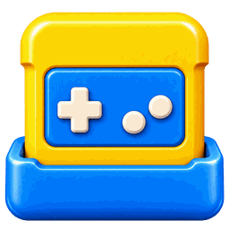
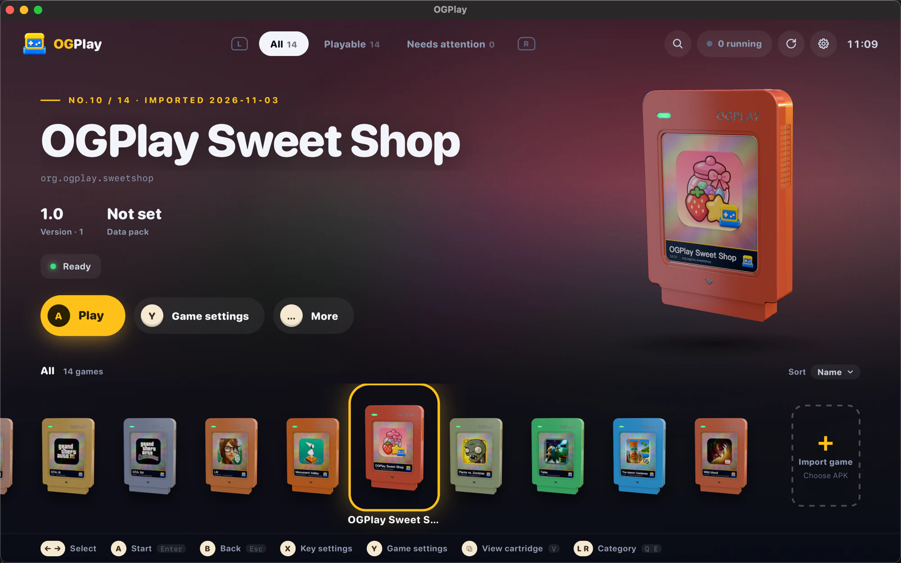
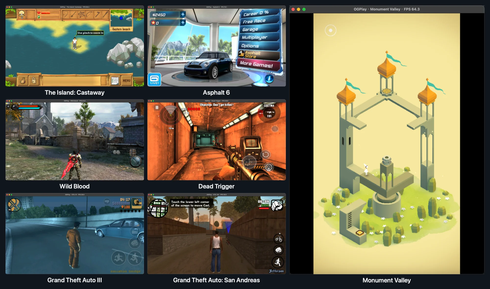
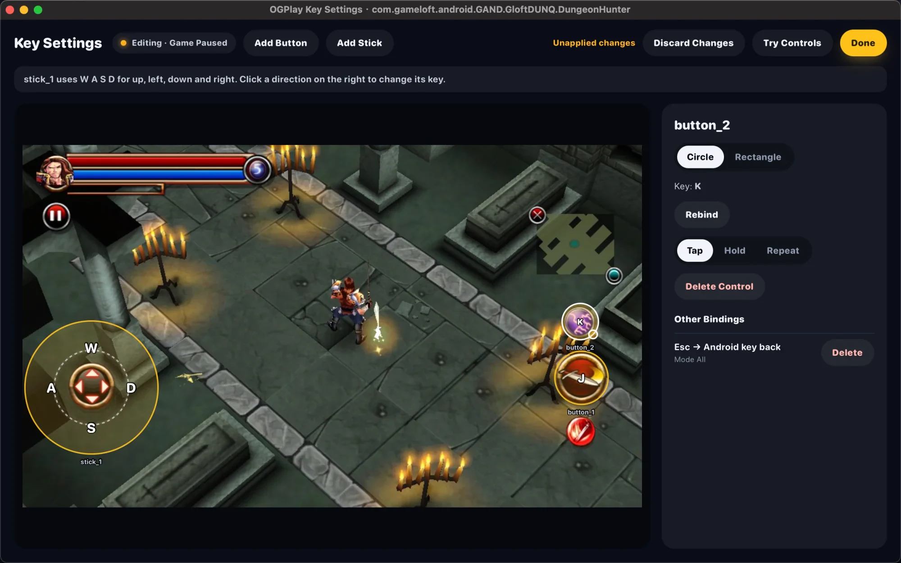
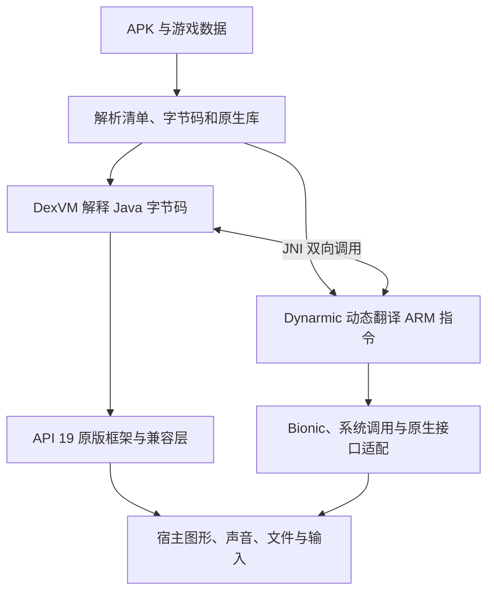

# OGPlay

**Android 经典游戏的跨平台兼容层**

不依赖 Android 系统镜像，让经典 Android 游戏在现代设备上重新运行

简体中文 | [English](README.en.md)

[效果截图](#效果截图) · [开始使用](#开始使用) · [兼容情况](#兼容情况) · [工作原理](#工作原理) · [后续计划](#后续计划) · [致谢](#致谢)

---

OGPlay 是一个 Android 老游戏兼容层，让经典安卓游戏在电脑上重新运行。原理类似 Wine，无需安装完整的 Android 系统。

> [!NOTE]
> 项目处于**早期 Alpha 阶段**。无法保证支持所有游戏。
> OGPlay 不附带商业游戏，只内置一款自制演示游戏。

## 效果截图

**游戏库界面**：

**游戏运行效果**：

**按键设置界面**：

## 开始使用

支持 macOS（13.3 及以上）和 Windows，Linux 版后续发布。

把 APK 拖进窗口，或点击“导入”按钮添加游戏，有数据包就一起选上，然后点击“开始游戏”。支持自定义键位，存档保存在本地。

导入数据包时请留意挂载位置：`Android/data`、`Android/obb` 等常见目录可自动调整，特殊路径仍需手动设置。

### 内置小游戏

为了开箱就能体验效果，OGPlay 自带一款可爱风格三消小游戏「OGPlay 糖果铺」，也可以在设置中移除内置游戏。

源码及素材：[samples/sweetshop](samples/sweetshop)。

编译好的 APK：[ogplay-sweetshop.apk](samples/sweetshop/out/ogplay-sweetshop.apk)。

## 兼容情况

OGPlay 当前主要适配 2010 - 2016 期间 Android 老游戏。

- **目标版本：** Android 4.4.4（API 19）
- **CPU 架构：** `armeabi` `armeabi-v7a`

目前已有十几款游戏可以运行，测试还不全面，其他游戏也可能兼容，欢迎尝试。同一游戏的不同版本也可能表现不同。

具体兼容情况：[兼容情况](docs/COMPATIBILITY.md)

## 工作原理

APK 中的 Java 字节码由自有 DexVM 解释执行，ARM 原生库由 Dynarmic 动态翻译，两者通过 JNI 互相调用。

Android 框架尽量复用 API 19 的原版 Java 代码，需要系统支持的部分由兼容层接到宿主系统。图形通过 ANGLE 渲染，SDL3 负责窗口、输入和音频输出，游戏文件和存档由虚拟文件系统管理。

## 后续计划

- 适配 Android & iOS 平台。
- 支持手柄操作。
- 运行时面板。
- 游玩时长等数据统计。
- 支持更多 Android 老游戏。（长期）

### 远期计划

- 支持同时期的 iOS 游戏。
- 支持更多游戏平台。

移动端、iOS 游戏与其他游戏平台支持均为未来计划，尚未开工，不属于当前可用功能。

## 致谢

OGPlay 建立在众多优秀的开源项目之上，感谢以下开源项目及其开发者：

| 用途 | 开源项目 |
| --- | --- |
| Android 运行与 ARM 翻译 | [Android Open Source Project](https://source.android.com)、[Dynarmic](https://git.eden-emu.dev/eden-emu/dynarmic) |
| 图形与窗口 | [ANGLE](https://chromium.googlesource.com/angle/angle)、[SDL](https://github.com/libsdl-org/SDL) |
| 音视频 | [FFmpeg](https://ffmpeg.org)、[minimp3](https://github.com/lieff/minimp3)、[stb](https://github.com/nothings/stb) |
| 纹理解码 | [Compressonator](https://github.com/GPUOpen-Tools/compressonator)、[PowerVR SDK](https://github.com/powervr-graphics/Native_SDK) |
| 数据处理 | [SQLite](https://sqlite.org)、[yyjson](https://github.com/ibireme/yyjson)、[Boost](https://www.boost.org) |
| 启动器界面 | [webview](https://github.com/webview/webview)、[Preact](https://preactjs.com)、[three.js](https://threejs.org)、[uPlot](https://github.com/leeoniya/uPlot)、[SN Pro](https://github.com/supernotes/sn-pro) |

这里只列直接依赖。包括间接依赖在内的完整清单、版本和许可证见 [THIRD_PARTY_NOTICES.md](THIRD_PARTY_NOTICES.md)，随包发布组件的许可证全文可在启动器的“关于”页查看。

## 免责声明

OGPlay 是独立的开源项目，与 Google、Android 开源项目及本文提到的游戏和厂商均无关联，也未获其认可。相关名称和商标归各自所有者所有，截图仅用于展示兼容进度。OGPlay 不提供商业游戏的 APK 或数据包，请只使用你合法拥有的游戏副本。

## 许可证

Copyright (C) 2026 OGPlay contributors.

除另有明确声明外，OGPlay 原创代码采用 **GNU Affero General Public License v3.0（仅第 3 版，SPDX: `AGPL-3.0-only`）** 发布。你可以依照该许可证使用、修改和再分发本程序；许可证全文见 [LICENSE](LICENSE)。本程序不提供任何担保，详见许可证条款。

第三方依赖、引入的上游代码及资源保留各自的版权和许可证，不因本项目的许可声明而改用 AGPL；使用及分发时仍须遵守它们各自的许可条件，清单见 [THIRD_PARTY_NOTICES.md](THIRD_PARTY_NOTICES.md)。
