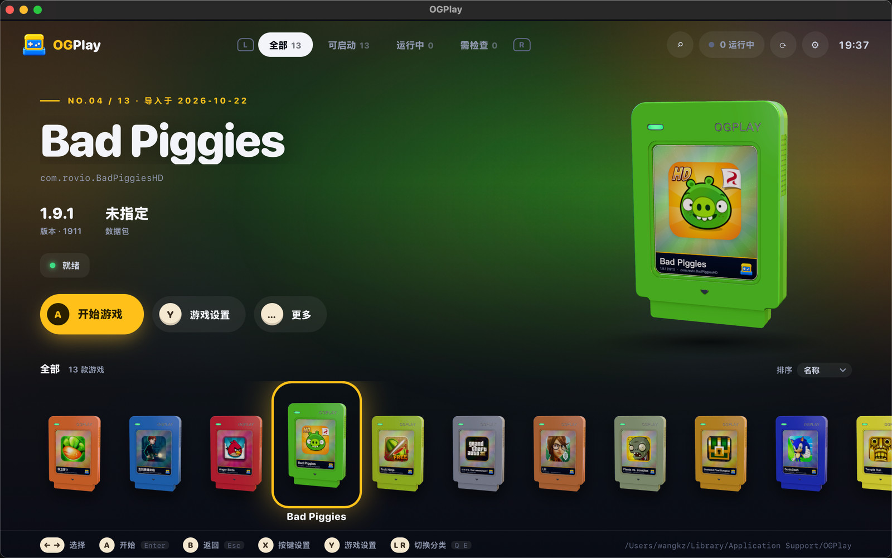

<div align="center">


# OGPlay

**Android 经典游戏的跨平台兼容层**

不依赖 Android 系统镜像，让经典 Android 游戏在现代设备上重新运行，项目仍处于早期 Alpha 阶段。

[](LICENSE)


简体中文 | [English](README.en.md)

[功能](#功能) · [开始使用](#开始使用) · [兼容情况](#兼容情况) · [后续计划](#后续计划)

</div>

---

OGPlay 让你尝试在电脑上运行经典 Android 游戏，把自己的 APK 和数据包整理到一个游戏库中，选择游戏即可启动，无需先启动完整的 Android 系统。



> [!NOTE]
> 项目仍处于**早期 Alpha 阶段，暂未发布版本**。部分游戏已能进入菜单或游戏场景，但尚不能保证完整游玩。OGPlay 不附带游戏，使用前需要自行准备 APK 和相应数据包。

## 功能

| 你可以做什么 | 使用体验 |
| --- | --- |
| **整理游戏收藏** | 导入 APK，以游戏图标和卡带浏览收藏，通过名称搜索游戏 |
| **添加游戏数据包** | 为需要额外资源的游戏选择数据目录，默认复制到游戏库，也可引用原目录 |
| **用键鼠操作** | 用鼠标点击、拖动，并将键盘按键映射为屏幕触摸；可在游戏运行时编辑按键 |
| **调整画面** | 设置画面宽高和超采样，可为每款游戏单独保存，也可使用全局设置 |
| **保留游戏进度** | 游戏存档保存在本地；从游戏库移除游戏时默认保留存档 |
| **独立运行游戏** | 游戏启动后，关闭启动器也能继续游玩 |

以上功能是否能在某款游戏中正常使用，仍取决于该游戏的兼容情况。

## 开始使用

### 1. 准备 OGPlay 和游戏文件

目前尚无可直接下载的安装包，只能从源码编译；而且现阶段的源码编译主要面向项目开发者，**全新克隆的仓库还不能直接编译出可运行的 OGPlay**（见下方“从源码编译”）。

| 平台 | 当前使用方式 |
| --- | --- |
| macOS | 编译后打开 `build/release/OGPlay.app`，使用图形启动器 |
| Windows | 编译后打开 `build/windows-msvc/Release/ogplay.exe`，使用图形启动器；Windows 版尚未完整验证 |
| Linux | 目前通过命令行使用，暂无图形启动器 |

<details>
<summary><b>从源码编译</b></summary>

基础工具：Git、CMake 3.25+、Ninja、支持 C++20 的编译器和 Python 3。

除此之外，以下运行所需的文件**不随仓库分发**，需要事先在本地准备：

| 内容 | 说明 |
| --- | --- |
| 启动器界面（`data/webui/`，仅 macOS / Windows） | 需要 Node.js 24 与 npm：在 `webui/` 目录执行 `npm ci` 和 `npm run build`。缺少时，默认配置下编译会直接报错停止 |
| Android 运行时数据（BootDex 与 API 19 骨架） | 由 `tools/bootdex/build_bootdex.py` 和 `tools/api19_skeleton.py` 生成，输入包括 Android 4.4.4 系统 framework jar、API 19 `android.jar` 和 Android build-tools 等。缺少时可以编译成功，但无法运行游戏 |
| WebView2 SDK（仅 Windows） | 运行 `webui/prepare-sdk.ps1` 准备 |

准备好上述文件后，在 macOS / Linux 上执行（Linux 只编译命令行，最后一步改为 `--target ogplay-cli`）：

```sh
git clone --recurse-submodules https://github.com/poping520/OGPlay.git
cd OGPlay
cmake --preset release
cmake --build --preset release --target ogplay ogplay-cli
```

Windows（Visual Studio 2026，在项目目录执行）：

```powershell
cmake --preset windows-msvc
cmake --build --preset windows-msvc --config Release --target ogplay ogplay-cli
```

这些准备步骤会随着发布流程完善逐步简化。

</details>

游戏文件需要准备单体 `.apk`；如果游戏另外附带数据包，也请一并准备。分包格式（如 XAPK、APKM、APKS）暂不支持。

### 2. 导入游戏

打开启动器，点击“选择安装包”，或将 APK 拖入窗口。检查游戏名称和版本后，点击“导入到游戏库”。

如果游戏需要外部数据，在导入窗口选择对应目录，并检查预览中的文件位置：

- **复制到游戏库**（默认）：导入完成后，OGPlay 使用库中的副本。
- **引用原目录**：直接使用所选目录，后续请勿移动或删除它。

不需要数据包的游戏可以跳过此步。

### 3. 启动与调整

在游戏库中选中游戏，点击“开始游戏”。需要调整画面时，打开“游戏设置”，修改画面宽高或超采样并保存，设置将在下次启动时生效。标为“预留”的选项尚未生效。

在游戏中用鼠标点击、拖动。需要配置键盘操作时，按 **F2** 打开按键设置，将按键映射到对应的触摸位置；按 **F1** 查看操作提示。目前不支持手柄，也不提供现成的官方键位模板。

### 4. 管理存档

退出游戏后，下次启动会继续使用本地保存的数据。选中游戏后，可在“更多”菜单中打开沙盒目录，查看和备份存档等游戏数据。

移除游戏时，默认保留存档，重新导入后可恢复使用；只有勾选“同时删除存档”才会一并删除。

<details>
<summary><b>通过命令行使用（包括 Linux）</b></summary>

导入 APK 并启动：

```sh
ogplay-cli library import game.apk
ogplay-cli library list
ogplay-cli library run <installation-id>
```

将最后一行的 `<installation-id>` 替换为列表中显示的游戏安装标识。

也可以直接运行 APK，并附带 OBB 数据包：

```sh
ogplay-cli run-apk game.apk --obb main.obb
```

从源码编译时，`ogplay-cli` 位于相应的构建目录；也可将其加入 PATH 后使用以上命令。更多选项见 `ogplay-cli --help`。

</details>

## 兼容情况

OGPlay 当前主要适配老版本 Android 游戏。**导入成功不等于可以完整游玩**，同一游戏的不同版本也可能表现不同。

目前已有部分游戏到达标题界面、菜单或实际游戏场景，但这些进展仍不代表全流程通关验证。最近的实测进度和已知问题见[当前状态](docs/state/CURRENT.md)。

游戏仍可能遇到画面异常、声音缺失、无法操作或退出失败。如果无法运行，先确认 APK 版本与数据包匹配；需要反馈时，请附上游戏版本、电脑系统、复现步骤和日志，可通过游戏的“更多 → 打开日志目录”找到日志，再到 [Issues](https://github.com/poping520/OGPlay/issues) 提交。

## 后续计划

- 让更多经典 Android 游戏可以稳定游玩。
- 探索在现代 Android 和 iOS 手机、平板上重温老游戏。
- 探索导入 `.ipa`，支持同时期的经典 iOS 游戏。
- 长期扩展到更多平台的经典游戏。

移动端、iOS 游戏与其他游戏平台支持均为未来计划，尚未开工，不属于当前可用功能。

## 许可证

Copyright (C) 2026 OGPlay contributors.

除另有明确声明外，OGPlay 原创代码采用 **GNU Affero General Public License v3.0（仅第 3 版，SPDX: `AGPL-3.0-only`）** 发布。你可以依照该许可证使用、修改和再分发本程序；许可证全文见 [LICENSE](LICENSE)。本程序不提供任何担保，详见许可证条款。

第三方依赖、引入的上游代码及资源保留各自的版权和许可证，不因本项目的许可声明而改用 AGPL；使用及分发时仍须遵守它们各自的许可条件。
