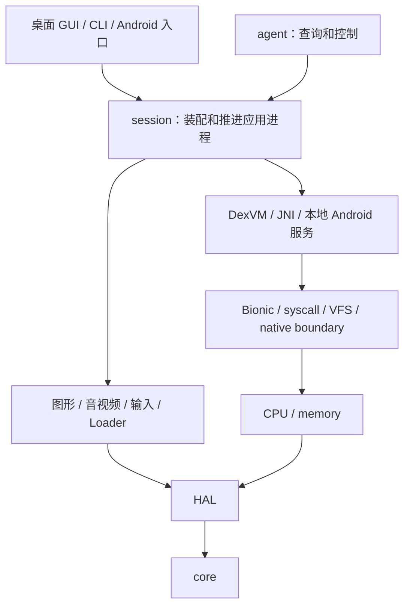

# OGPlay 总体架构

OGPlay 要解决的是让一个 Android 老游戏的应用进程在宿主上运行。
游戏的 ARM 机器码、应用 DEX 和随附 Android ROM 中的 Java 代码仍各自执行，
兼容层把它们连接到同一组对象、文件、线程、时间和设备资源。
这里的 guest 指被兼容的 Android 环境，宿主指运行 OGPlay 的系统。

理解这个设计，可以从“导入一个 APK，直到窗口出现第一帧”入手。
导入决定来源与安装身份，进程装配建立执行环境，ROM framework 驱动应用启动，
图形生产者提交内容，前端呈现最终画面。每一步都复用通用能力，
具体游戏的入口、资源与用户设置通过数据传入。

## 为什么以应用进程为边界

兼容层保留应用已有的算法，把适配集中在应用接触外部环境的位置。
原生代码中的 libc 算法执行真实 Bionic；应用和 ROM 的 Java 方法由 DexVM 解释；
文件、内存、图形、音频和进程内服务在明确接口处接入宿主。
这使兼容工作围绕共享的 Android 行为积累，而不是为每个游戏翻译一份胶水代码。

[进程级范围决定](../adr/runtime.md#adr-0001)选择了这一边界，
代价是游戏依赖的系统能力需要逐项提供，缺口会在真实调用处暴露。
项目不启动 Android 系统镜像，也不实现 Zygote、system_server 或 Binder 驱动。
进程内服务可以回答本进程的问题，却不能据此宣称提供了完整 Android 系统。

[ROM 执行决定](../adr/dexvm.md#adr-0017)进一步把普通 Java 协议留给原版代码。
例如生命周期中的回调、消息和对象副作用由 ROM ActivityThread 执行，
宿主提供它需要的 native 与服务接口。这减少了两套生命周期算法发生偏差的机会，
同时要求 VM 和服务边界能够支撑 ROM 实际触达的调用链。

## 分层怎样协作



图中上层组合下层能力。core 提供日志、账本和基本数据工具，HAL 隔离宿主平台接口；
memory 管理 guest 地址空间，CPU 执行指令，Loader 解析 APK、DEX、ELF 与资源格式。
runtime 将这些机制连接成一个 Android 进程，session 决定其启动、推进和停止，
frontend 则拥有宿主窗口、事件循环和用户交互。

回调通过装配时注入的接口返回，而不是让下层寻找全局 session。
例如 CPU 只报告陷阱，具体陷阱属于 syscall 还是 JNI，由上层装配决定。
这个分工让无窗口链接预检、独立 DEX 探针和真实游戏运行复用底座，
代价是装配层需要明确安排接口及其寿命。精确依赖见
[模块契约索引](../modules/INDEX.md)和[运行时分层决定](../adr/runtime.md#adr-0013)。

## 从导入 APK 到进程装配

游戏库先读取单体 APK 的 Manifest、名称、图标和原生库清单。
Manifest 提供 MAIN/LAUNCHER 入口，原生库清单提供可选 ABI。
Profile 是按精确应用身份匹配的描述数据，当前只承担 identity 覆盖；
没有 Profile 的 APK 也使用同一条通用启动路径。

一次导入建立一个安装实例。实例身份与包名分开，使同包副本有独立的存档、设置和
ANDROID_ID。APK、OBB 与外部数据是只读来源，guest 写入进入该实例的持久沙盒。
移除游戏库卡片与删除存档因此可以分别操作，文件布局见[存储设计](storage-security.md)。

显示尺寸、密度、输入配置等有效设置按游戏、全局、默认值解析。
共享游戏库生成受检启动选项，GUI 与 CLI 使用同一套校验和参数格式化。
这种组织避免预览参数与实际启动参数分叉，前端增加设置时则需要接入共享 schema。
选择依据见 [Profile 与用户设置边界](../adr/session.md#adr-0142)。

进程装配先建立 API19 系统 ELF、地址空间、TLS、syscall 与 native 边界。
TLS 是每线程独立的数据区，Bionic 用它保存线程相关状态。
这里先建立系统环境，应用自己的 SO 随后沿 Java 标准加载链按需加载，
构造器与 JNI 初始化因而发生在应用实际请求的位置。

VM 登记平台目录、启动类路径和应用 DEX。BootDex 是项目对启动类路径及其构建加载机制的称呼，
当前由自有 ogplay.jar 与原样 API19 ROM jar 组成。
每个 DEX 保留所属归档与解析上下文，应用和 ROM 使用同一个对象模型与 JNI 身份。
类的层级和成员按需链接，未触达的可选类不阻断整个进程装配。

## ROM 怎样启动应用

```text
AndroidAppProcess
  → ActivityThread.attach(false)
  → 本地 AMS 投递 bindApplication
  → ROM 创建 Application
  → 主队列首次空闲
  → 启动 Manifest launcher Activity
  → ActivityThread / Looper / ViewRootImpl 持续工作
```

首先，AndroidAppProcess 组合 Manifest、native 进程与 VM bridge。
随后本地 AMS（Activity 管理服务）向 ROM 的应用线程接口投递请求。
Application 创建完成且主队列到达首次空闲后，launcher Activity 才开始启动。
这样的顺序让 Application 初始化和排队任务的副作用自然进入后续生命周期。

Java 主 Looper 由独立宿主线程持续执行。Looper 是 Android 的线程消息循环，
它与 Handler、MessageQueue 共同决定消息和回调顺序。
session 提交启动、挂起、恢复与关闭请求，并等待明确的队列进展；
它不保存一份按游戏录制的方法调用序列。

若应用真正调用了缺失成员或未绑定 native，错误沿相应 Java 或 native 边界传播。
惰性链接只推迟检查到有意义的位置，不为已触达的能力补默认成功结果。
完整流程及本地服务关系见[Android 平台层](android-framework.md)。

## 第一帧怎样到达屏幕

软件界面由 ROM ViewRootImpl 调度测量、布局和绘制，Canvas native 把绘图操作交给 Skia。
原生 EGL/GLES 与 Java GLES 通过同一图形边界进入 ANGLE；
视频解码后也以窗口 Surface 为目标。Surface 在这里表示图像生产端与窗口内容之间的身份连接，
并不等同于宿主窗口指针。

WindowSystem 保存窗口几何、层级、可见性和图层内容，按裁剪、透明区与 alpha 合成。
FrameService 再发布统一序号的 RGBA 帧，前端经 HAL 呈现。
把软件、EGL 和视频放入同一合成路径，能够保留 Dialog、SurfaceView 等窗口之间的遮挡关系，
随之要管理在途帧、像素寿命与不同生产者的节奏。

呈现完成与 guest 产生一帧是不同的事实。前端可以丢弃过期内容，也可以等待尚未完成的读回；
因此源帧序号和实际成功呈现次数分别统计。截图只读取最近已呈现帧，
不为了取得图片额外推进应用。具体内容见[图形设计](graphics.md)与[诊断设计](diagnostics-testing.md)。

## 用一个混合界面检查分工

设想应用的主画面由 EGL 绘制，点击设置后打开 ROM Dialog。
EGL 线程仍拥有自己的 Context，Dialog 的 View 树则在 Java 主 Looper 中测量和绘制。
两者不是互斥的运行模式：它们提交不同窗口的内容，由同一个 WindowSystem 排层。
这也是“运行 ROM 界面”与“兼容原生渲染”需要共用进程事实的原因。

```text
EGL 线程：游戏绘制 → swap → 主窗口图层 ─┐
                                       ├→ 窗口快照 → 最终帧
主 Looper：Dialog 布局 → Canvas → 对话框层 ─┘
```

用户点下时，输入先落在逻辑显示，再由窗口系统选定 Dialog。
应用自己的 ViewGroup 处理内部拦截，确认或取消的 Listener 仍执行应用 Java。
关闭 Dialog 只是移除对应窗口，不能把整个 EGL 进程或共享对象命名空间一并销毁。
由此可以沿一条具体交互核对各层的身份与寿命，而不是只检查某个 API 有没有返回。

如果此时发生方向变化，显示配置先影响窗口几何与资源选择，
ROM 决定 Activity 接收配置还是重建。旧帧可能仍在前端使用，新帧则携带新布局；
回收存储按帧本身校验，不用新方向反推旧帧尺寸。
输入序列取消后重新起手，避免把旧屏幕上的按住位置移到另一控件。

同样的分工也适用于排障：画面错层先看窗口事实和图层来源，
控件布局错误看 ROM 资源与软件绘制，顶点或纹理错误看 GLES 搬运与 ANGLE。
这些是定位入口，不是按症状自动确定根因；
组合路径的最终结果仍需真实运行和画面对照。

## 一致的身份、状态与时间

跨层最容易出错的是把不同身份压成同一个数字。guest 地址、Java 对象、JNI 引用与
native 资源令牌分别有自己的含义；强类型包装与受检转换保留这种区别。
owner 指负责某项资源存活、停止调用和最终释放的对象；借用只延长被借资源的寿命，
不会自动取得对象的全部管理权限。

普通 Java 字段和数组只有一份权威状态，native peer 只保存下层资源及必要适配状态。
peer 指与 Java 对象关联的 native 资源。例如 Bitmap 的 Java 像素数组可被 Skia 与 NDK
借用，但不会再维护另一份需要同步的影子像素。这减少复制和状态分叉，
也要求 GC、pin 与显式释放协同，见[对象所有权决定](../adr/dexvm.md#adr-0029)。

一个 guest 线程对应一个宿主线程，原生线程各自拥有 CPU、栈与 TLS。
Java 解释由可重入执行锁串行，阻塞时释放完整递归深度，恢复后再重建。
这既保留真实阻塞与回调，又控制解释器并发访问对象图的复杂度，
Java 字节码本身因此没有并行解释收益。

Clock 是会话统一的时间入口。时间查询、等待、音视频推进和退出 deadline 都从这里取得依据，
实时推进与手动步进各有消费规则。CPU tick 只是执行预算，宿主帧率限制只是呈现节奏，
二者都不能替代 Android uptime。理由见[线程与 Clock 决定](../adr/runtime.md#adr-0004)。

## 失败与关闭怎样收敛

未实现能力的处理取决于它对应用语义的影响。无返回值的纯展示设置可以忽略并记录 UI 降级，
而文件、内存、GL、线程、音频及逻辑返回值需要真实结果或明确错误。
设备缺席也可以是准确答案，例如空传感器目录，但查询缺席不代表相应操作已实现。
精确降级边界见[平台成员决定](../adr/dexvm.md#adr-0147)。

健康关闭先尝试 ROM 生命周期处理，在其需要的时间内保留图形与音频等依赖，
再停止消费者、取消并等待工作线程，最后退役资源。
运行首错与清理错误分别保存，避免最后一次析构掩盖真正的失败原因。
有界协作清理不能保证打断任意第三方库内部等待，范围见[退出决定](../adr/diagnostics.md#adr-0025)。

机制已连接并不等于游戏已经验收。reached-fault 表示相同路径越过原首错并记录下一首错；
title gate 表示精确 APK 与固定场景的正式兼容验收。
当前到达点见[运行状态](../state/CURRENT.md)，跨会话限制见[已知问题](../state/KNOWN-ISSUES.md)。

## 怎样阅读实现而不混淆证据

总览中的箭头表示职责流转，不保证每个下层在每次调用都参与。
纯 Java 游戏可以建立系统 native 环境却没有应用 SO，
纯查询可以只读封存事实而不执行 guest，
完整覆盖的 EGL 图层也可以跳过一次额外像素合成。

阅读时先确定权威状态，再找转换边界，最后看完成与释放的位置。
例如对一帧图像，权威内容来自生产者，窗口系统给出层级和几何，
FrameService 发布序号，前端给出成功呈现次数；
这四种事实不能用一个 frame 数字互相替代。

相应地，能力账本、运行状态与设计各回答不同问题。
账本说明声明范围和验证入口，状态说明最近到达点，设计解释为何如此分工。
把它们分开维护能减少复制清单失效，但阅读一个具体问题时可能需要跨两三个入口核对。

## 子系统导读

| 文档 | 主要问题 |
| --- | --- |
| [guest 执行环境](guest-execution.md) | ARM、内存、Bionic、syscall、线程与信号 |
| [native 边界](native-boundary.md) | Virtual SO、Fast Host Call 与 JNI 互通 |
| [DexVM](dexvm.md) | 类链接、解释、对象、GC、反射与启动类路径 |
| [Android 平台层](android-framework.md) | ROM 生命周期、服务、资源、窗口与帧调度 |
| [图形](graphics.md) | EGL/GLES、ANGLE、状态与 Surface 生产 |
| [音频与视频](audio-video.md) | PCM、编码媒体、Clock 与输出 |
| [存储与安全](storage-security.md) | VFS、持久沙盒、SQLite、KeyStore 与 TLS |
| [输入映射](input.md) | 设备事件、合成触点与用户配置 |
| [前端](frontend.md) | 共享外观、游戏库、GUI、CLI 与 Dashboard |
| [诊断与测试](diagnostics-testing.md) | 同源状态、停滞取证、MCP 与场景 |

阅读源码前，可从[模块契约索引](../modules/INDEX.md)确认职责与依赖，
再按[操作手册](../playbook/README.md)选择验证入口。
设计文档解释机制与取舍，精确接口和不变量由对应 MODULE.md 维护。

## 契约、决定与操作

- [模块契约索引](../modules/INDEX.md)、[session 契约](../../src/session/MODULE.md)
- [进程级范围](../adr/runtime.md#adr-0001)、[真实线程与 Clock](../adr/runtime.md#adr-0004)
- [ROM 与 DexVM 边界](../adr/dexvm.md#adr-0017)
- [操作手册](../playbook/README.md)、[当前状态](../state/CURRENT.md)
- [已知问题](../state/KNOWN-ISSUES.md)
