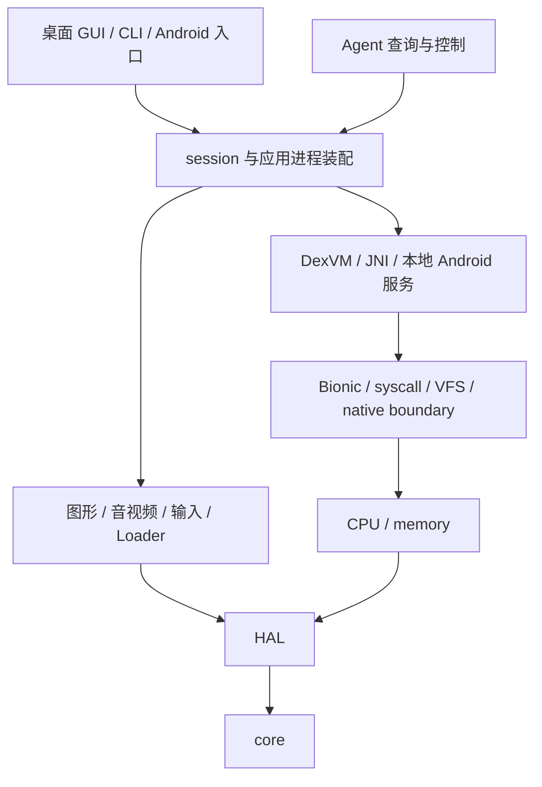

# OGPlay 总体架构

OGPlay 让 Android 老游戏的应用进程在宿主上运行。
ARM 机器码、应用 DEX 和随附 ROM Java 各走自己的执行路径，
在同一进程模型中共享对象、文件、时间、线程和图形资源。
这些设计文档面向希望理解子系统的人类开发者；精确边界以模块契约为准。

## 目标与范围

兼容层关注游戏进程直接调用的能力，包括进程内运行的 ROM framework。
Android 的 Java 代码尽量整类原样执行；宿主实现 native 和本地服务接口。
原生代码使用真实 Bionic，宿主在 syscall 和显式 native 边界提供能力。
应用看到的是一致的虚拟设备事实，而不是宿主设备信息的任意拼接。

项目不启动 Android 系统镜像，不实现 Zygote、system_server 或 Binder 驱动。
本地 Binder 对象只是同一 VM 中的接口调用，不承担 IPC。
Play 服务、现代支付、社交与反作弊不在范围内。
范围判断的依据是进程实际依赖，不能由某一款游戏的调用顺序决定。

## 分层与依赖



图中表示主要职责关系；实际编译依赖以各 MODULE 为准。
下层不会通过全局对象寻找 session，也不直接操纵前端窗口。
需要回调时，由装配层注入明确接口并负责撤销。
这使独立命令、无窗口测试和真实窗口运行能够复用同一内核。

core 提供结构化日志、能力账本、JSON 与基本数据工具。
HAL 隔离 SDL3、宿主文件和平台服务。
memory 维护 guest 地址空间，cpu 执行 ARM 指令。
Loader 解析 APK、DEX、ELF 和资源格式，执行前先检查输入结构。
runtime 将这些机制组织为一个 Android 应用进程。
session 决定何时启动、推进、挂起和停止。
frontend 拥有用户交互和宿主事件循环。
Agent 暴露同源结构化状态，并把控制请求排队给运行线程。

## 从导入 APK 到第一帧

### 导入与实例身份

游戏库检视单体 APK，读取 Manifest、图标、名称与原生库 inventory。
导入建立安装实例；同包多个实例可以各自保存设置、数据和设备身份。
APK 与可选数据包是读取来源，持久沙盒承接 guest 写入。
Profile 仅作精确身份覆盖，不提供 Java 补丁、入口调用序列或资源清单。

### 解析启动配置

共享游戏库解析游戏设置、全局设置和内置默认值。
入口来自 Manifest MAIN/LAUNCHER，ABI 来自 APK 原生库 inventory。
逻辑显示尺寸、密度、超采样和输入配置由用户设置提供。
前端据此创建宿主窗口，并将受检配置交给统一运行服务。
GUI 与 CLI 使用同一解析和参数格式化路径。

### 建立应用进程

原生进程先装配 API19 系统 ELF、地址空间、Bionic TLS、syscall 与边界服务。
这个阶段不把某个 APK SO 当作固定 root 预先执行。
应用随后通过 Java 标准加载链按需加载自己的 native 库。
Virtual SO 发布已声明的完整导出，不随初次 imports 裁剪。

VM 先登记 core/Android catalog，再登记启动类路径和应用 DEX。
启动类路径包括自有 ogplay.jar 和原样 API19 ROM jar。
DEX 内容与归档寿命由拥有型来源保持，不依赖调用方的临时缓冲。
应用与 ROM 使用同一解释器、对象模型和 JNI 身份。

### 启动 Java 主线程

```text
AndroidAppProcess
  → ActivityThread.attach(false)
  → 本地 AMS 投递 bindApplication
  → ROM 创建 Application
  → 主队列首次空闲
  → 启动 Manifest launcher Activity
  → ROM ActivityThread / Looper / ViewRootImpl
```

主 Looper 在独立宿主线程持续执行。
session 通过进程内 AMS 提交生命周期请求，等待明确的队列进展。
它不直接调用一组预先录制的游戏 Java 方法。
未触达的 ROM 可选类不会因为存在依赖缺口而一概阻断启动。
真正触达的缺类、缺成员或未绑定 native 则按对应错误边界失败。

### 绘制与呈现

ROM ViewRootImpl 负责测量、布局和软件绘制调度。
Canvas native 把像素交给 Skia；EGL/GLES 经统一 boundary 调用 ANGLE。
SurfaceView、软件窗口和视频生产者向同一 WindowSystem 提交图层。
WindowSystem 按 frame、crop、透明区与 alpha 合成。
FrameService 发布不可变 RGBA 帧，前端通过 HAL 呈现。
第一帧必须来自实际生产者提交，空截图或成功加载类不算画面验收。

## 贯穿各层的身份与所有权

guest 地址使用强类型包装，不能把宿主指针编码成 guest 值。
Java 对象身份、JNI 引用和 native 资源令牌是不同概念。
跨边界传递时显式转换，不能用一个数字同时代表多种所有权。
对象图只有一份权威字段；native peer 只保存下层资源和必要状态。

一个 guest 线程对应一个宿主线程。
Java 解释由可重入 VM 执行锁串行，阻塞时按原递归深度释放并恢复。
原生线程有独立 CPU、栈和 TLS，共享进程地址空间与同步底座。
所有时间读取、等待与媒体推进经统一 Clock。
手动步进、实时推进和关闭预算具有各自明确的消费规则。

## 成功、降级与失败

可选硬件缺席可以是正式结果，但必须符合 Android 本身的接口语义。
未实现的展示设置可记录 UI 降级；逻辑返回值和底层能力不能伪造成功。
运行时未实现命中进入能力账本，Java 异常仍按 Java 语义传播。
Survey 的中性返回只用于诊断，不能成为兼容性证据。

关闭先请求 ROM 生命周期处理，再停止媒体和工作线程，最后退役资源。
有界清理保留原始故障，后续清理异常不能覆盖它。
停止一个 guest 进程也不能终止承载它的宿主进程。
当前运行到达点和未关闭项分别见状态文档与已知问题。

## 子系统导读

| 文档 | 主要问题 |
| --- | --- |
| [guest 执行环境](guest-execution.md) | ARM、内存、Bionic、syscall、线程与信号 |
| [native 边界](native-boundary.md) | Virtual SO、Fast Host Call 与 JNI 互通 |
| [DexVM](dexvm.md) | 类链接、解释、对象、GC、反射与启动类路径 |
| [Android 平台层](android-framework.md) | ROM 生命周期、服务、资源、窗口与帧调度 |
| [图形](graphics.md) | EGL/GLES、ANGLE、状态与 Surface 生产 |
| [音频与视频](audio-video.md) | PCM、编码媒体、Clock 与输出 |
| [存储与安全](storage-security.md) | VFS、持久沙盒、SQLite、KeyStore 与 TLS |
| [输入映射](input.md) | 设备事件、合成触点与用户配置 |
| [前端](frontend.md) | 共享外观、游戏库、GUI、CLI 与 Dashboard |
| [诊断与测试](diagnostics-testing.md) | 同源状态、停滞取证、MCP 与场景 |

## 术语

| 术语 | 本项目含义 |
| --- | --- |
| guest / 宿主 | 被兼容的 Android 应用环境 / 运行 OGPlay 的系统 |
| ROM Java | 随附 API19 jar 中原样执行的 Java 实现 |
| BootDex | 启动类路径及其构建、加载机制的惯用称呼 |
| native boundary | guest ABI 到宿主能力的受检调用边界 |
| Virtual SO | 由 catalog 提供 ELF 导出的合成共享库 |
| payload | 随附运行库或 Java 数组等稳定存储，含义由上下文区分 |
| owner | 负责资源寿命、停止调用和最终释放的对象 |
| reached-fault | 同一触发路径越过原首错并记录下一首错的证据 |
| title gate | 对精确 APK 与固定场景进行正式兼容验收 |

## 契约、决定与操作

- [模块契约索引](../modules/INDEX.md)、[session 契约](../../src/session/MODULE.md)
- [进程级范围](../adr/runtime.md#adr-0001)、[真实线程与 Clock](../adr/runtime.md#adr-0004)
- [ROM 与 DexVM 边界](../adr/dexvm.md#adr-0017)
- [操作手册](../playbook/README.md)、[当前状态](../state/CURRENT.md)
- [已知问题](../state/KNOWN-ISSUES.md)
