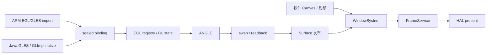

# 图形、EGL 与帧生产

图形子系统负责把 Android API19 的 EGL/GLES 调用接到 ANGLE，
并把完成的图像交给窗口合成。它同时面对两种调用者：ARM 原生代码通过 ELF 导出调用，
ROM 的 Java GLES 或 GLImpl 通过 native 调用。两者共享 Context、对象和错误状态，
只是参数进入边界的方式不同。
Context 是保存一组绘制状态的执行上下文，Surface 是承接绘制结果的独立图像存储；
线程把两者绑定为 current 后，后续 GL 调用才有明确目标。

理解这条路径，可以跟随一次 `glDrawArrays`：ARM 调用跳板进入已封存的函数绑定，
边界找到当前 Context，验证顶点来源并暂存需要的 guest 数据，ANGLE 执行绘制。
随后 `eglSwapBuffers` 才把该 Surface 的内容交给窗口系统；绘图调用本身并不呈现画面。

## 调用流与主要构件



sealed binding 指装配后只读的函数与 handler 绑定，详见[native 边界](native-boundary.md)。
EGL registry 是进程内管理 Display、Context、Surface 逻辑身份的对象表，
GL state 保存 Context 的绑定和搬运所需状态。底层 gles 模块隔离 ANGLE 与图像搬运，
boundary 管理 guest ABI，Android 平台层把 ROM Surface 连到具体窗口。

图中两种 API 入口在状态层汇合。Java 适配只处理数组、Buffer、字符串和句柄编组，
不会创建第二个 registry。否则 Java 创建的纹理可能无法被原生代码使用，
同一线程的 current 和错误也会分裂。共享状态的设计依据是
[EGL 对象决定](../adr/media.md#adr-0063)。

## 为什么让 ANGLE 承担 GLES 语义

ANGLE 负责 shader、对象、状态机与平台驱动连接。
[ANGLE 决定](../adr/media.md#adr-0003)选择它，是因为逐函数把 GLES 翻成桌面 GL
容易在状态、枚举和能力上报处出现偏差。OGPlay 因此把工作集中在 guest ABI、
内存搬运和 Android Surface 交付，而不是维护另一套桌面 GL 兼容实现。

随之而来的维护工作是固定 SDK 的来源、头文件与运行库要匹配，各后端能力也要分别核对。
SDK 由预编译仓库提供，普通开发不承担完整 ANGLE 源码构建链。
平台和清单不匹配时明确失败；无 ANGLE 的构建也不会转向系统 EGL。
软件渲染同样使用 ANGLE 的 Vulkan/SwiftShader 路径，hardware-only 保留硬件选择语义。

宿主存储可以是内部 pbuffer，即离屏像素表面，而 guest 仍看到逻辑 window surface。
因此一个 Android Surface 既不是 SDL 窗口，也不是宿主窗口指针。
把生产存储与最终呈现分开后，多个窗口内容可以统一合成；
相应地，swap 后需要读回或交付像素，并管理这些像素的寿命。

## EGL 对象为什么独立拥有资源

```text
Display
  ├─ Config
  ├─ share group → Context A / Context B
  └─ Surface X / Surface Y
thread current = Context + draw Surface + read Surface
```

Display 与 Config 描述可用显示及存储配置。每个 Context 对应一个 native Context，
每个 Surface 独立拥有像素存储。share group 是在 Context 创建时建立的对象共享组，
使纹理和 buffer 内容可以共享，同时各 Context 保留自己的绑定与错误状态。

这种结构能表达 Context 切换、不同 draw/read Surface 和共享对象。
如果把 Context 与 Surface 合成一个进程唯一图形对象，这些合法关系就会丢失。
代价是绑定、销毁和共享组退役都要按各自身份处理，而不是销毁一个总对象即可完成清理。
精确关系见 [EGL 契约](../../src/runtime/boundary/modules/egl/MODULE.md)。

registry 向 guest 发布单调逻辑句柄，current、bound API 与 EGL error 按线程隔离。
owner 在这里指实际占用 Context 的宿主线程；跨线程使用先显式解绑再移交。
当前对象的销毁可以延迟至解绑，避免仍在执行的 ANGLE 调用失去存储。
失败绑定保留原 current，使调用失败不会顺带改变后续绘制目标。

`eglGetProcAddress` 在冷路径查询封存目录，返回稳定 thunk。
同名入口按调用线程的实际 client version 路由，而不是由 ELF 依赖顺序决定。
这使一个混合链接进程可以保留 GLES1 与 GLES2/3 的明确调用语义，
未知扩展则返回空结果，不把驱动导出存在直接当作 guest 支持。

## 一次 glDrawArrays 的准备与执行

绘制首先取得当前 Context 的绑定状态。标量按 ARM 或 JNI 位型解码，
client array 保存定义时的 buffer binding；draw 时才根据 first/count 验证需要的属性字节。
这里 client array 指顶点数据仍位于 guest 内存的数组，而 VBO offset 是已绑定 GL buffer 内的偏移。
二者虽然都能放进一个整数参数，读取方式却不同。

若数据来自 guest 数组，边界完整预检并重新读取需要的范围，再用内部 VBO/VAO 等资源暂存。
若来自 VBO，则保留真实 buffer 身份和偏移。索引绘制还需读取实际索引范围，
避免仅凭 count 低估属性访问区间。暂存容量可复用，输入内容不会跨调用缓存。

准备完成后，`AngleFrame::DrawArrays` 转发到 ANGLE。
内部 staging 使用的 shader、VAO 和 buffer 不作为 guest 对象发布，
临时绑定在成功或异常出口恢复。这样 guest 后续查询仍反映自己的状态，
为此每个内部操作都要保存和恢复它触及的绑定。

Java GLES 数组或 Buffer 入口使用同样的准备与执行服务。
一个由 Java 设置、原生代码绘制的 Context 因而观察到同一套顶点和对象状态，
参数编组不同不会产生第二条渲染语义路径。

## 状态、错误与输出搬运

每个 Context 保存固定管线、client array 和 binding；共享组保存可共享对象元数据。
对象名由 ANGLE 生成，shadow 是为 guest 查询或搬运保留的必要逻辑记录，
只在真实 mutation 成功后更新。真实查询与 shadow 各有明确来源，
未知 pname 不靠猜测输出长度处理。

错误按来源分开报告：guest 参数枚举错误沿该 API 的 GL/EGL 错误协议返回，
guest 指针越界保留受检内存错误，后端缺实际能力则记录对应缺口。
内存越界、生命周期与宿主逻辑故障不会统一伪装成 GL 枚举错误，
排查时才能分清调用者、搬运层与后端谁需要继续追查。

GL 首错按 Context 锁存，`glGetError` 先消费锁存错误，再查询 ANGLE。
`glGetError` 是消费型查询，Dashboard 的快照则不是：诊断接口只观察，不消费错误。
监控打开前后应用应看到相同的待消费错误，否则一次截图或状态查询就可能让复现失效。
为此需要额外维护只读诊断接口，而不是直接调用 guest 查询函数取值。

输出参数在调用 ANGLE 前取得写入预检，成功后显式提交。
像素范围由 pack/unpack alignment、row/skip 与 PBO offset 共同决定；
PBO 是用来搬运像素的 GL buffer，offset 并非 guest 地址。
这些计算集中在搬运层，防止每个 handler 自行解释长度而产生不同边界。

buffer mapping 使用受检 guest arena，记录真实 buffer、共享组、范围与 flags。
显式 flush 只回写指定范围，unmap 不重复覆盖已提交内容。
这样保留了映射 API 的可见性，删除对象与最后 Context 退役时则需要清理关联映射。
细节见 [services](../../src/runtime/boundary/services/MODULE.md)。

## GLES1 与 GLES2/3 的分工

GLES1 固定功能状态被转换为 ANGLE 能执行的 shader 与受检顶点数据。
矩阵、lighting、fog、alpha-test 和 texture environment 都影响生成的绘制；
多纹理 stage 各自保留坐标、矩阵和 sampler。
如果只保存 setter 值却不让其进入绘制，查询虽然像是正确，画面仍会失真。

固定管线转换需要内部 shader 和数据展开，例如 flat shading 按 primitive 的 provoking vertex
处理颜色。所以该路径比直接转发 GLES2 更复杂，point size、matrix palette、texture crop
等支持边界也要逐项明确。具体枚举留在 [GLES1 契约](../../src/runtime/boundary/modules/gles1/MODULE.md)。

GLES2/3 的 shader、program、uniform 与 framebuffer 语义由 ANGLE 执行。
边界读取真实 active uniform 的形状，relink/delete 清理旧 metadata，
使查询不会按过时宽度写出 guest 输出区。
GLES3 共用入口仍保留自己的参数范围，不退回较窄的 GLES2 规则。

API19 导出表与后端可执行能力分别管理。
为固定桩库提供可解析入口，并不等于所有后端都支持该入口；
缺能力的 GL 路径按已定义规则记账，也不会读取未支持调用的指针或扩大发布扩展。
EGL 则使用自己的校验、返回 ABI 与错误协议。

## 扩展怎样形成一致视图

压缩纹理先由真实后端能力与已实现的软件解码形成 available 集合，
再由进程策略收窄为 published 集合。格式数组、数量、上传校验与扩展字符串都从同一集合生成。
这让“宣称能接收某格式”和“真正能完成上传”保持一致，
每条软件回退路径也因此要承担格式、长度与错误验证责任。

ETC1、ATC 和 PVRTC 只有在真实原生或已实现解码路径存在时才参与发布。
解码后的 RGBA 仍交给 ANGLE，未知格式不会借通用回退假装支持。
这种边界延续 [EGL 对象决定](../adr/media.md#adr-0063)对受检扩展的要求，
精确格式由 [gles 契约](../../src/gles/MODULE.md)维护。

## swap 与读回

`eglSwapBuffers` 发布 draw Surface，保留 read framebuffer 的 guest 绑定。
`glFlush` 只是提交命令，不推进呈现序号；
把它当 swap 会使应用尚未完成的绘制过早进入合成。

内部读回必须与 guest 状态隔离。设想应用绑定了一个用户 FBO 作为读取目标，随后交换默认
draw Surface。若内部读回直接改 guest read binding，下一次应用自己的 glReadPixels 就可能读错对象。
因此内部呈现只处理目标 Surface 所需存储，并恢复自己临时修改的 pack、buffer 与 framebuffer 状态。
这里的“恢复”是维持 API 可观察状态，不是把所有 ANGLE 内部状态快照一遍。

```text
guest 读状态 ── 保存 ──────────────── 恢复 ─→ 后续查询 / glReadPixels
                     ↓
               内部读回 draw Surface
                     ↓
               顶部首行 RGBA → 窗口层
```

像素方向也在这个边界归一化。GL 读回与窗口图像的行原点不同，
内部读回统一转换为顶部首行的 RGBA，使窗口、截图和视频消费者共用方向约定，
无需各自再判断一次。无法使用原生反向打包时需要在宿主翻转，
这项搬运成本与 GLES 绘制语义分别管理。

超采样只放大默认 framebuffer，guest FBO 保持逻辑尺寸。
最终 resolve 回到逻辑分辨率，查询继续报告逻辑坐标。
这种选择使用户的画质设置不改应用自身的渲染目标与输入几何，
代价是增加默认目标存储和一次受控缩小。

## 窗口交付与像素借用

WindowSystem 合成后由 FrameService 发布统一序号与指标。
[帧交付决定](../adr/media.md#adr-0140)把呈现读回留在拥有 Context 的一侧，
窗口消费者只接收完成图像。旧窗口、尺寸或 Context 的异步结果因此要核对身份后才发布，
以免覆盖已旋转或重建后的新画面。窗口关系见[Android 平台层](android-framework.md)。

pixel lease 是附带保活对象的不可变像素借用，使在途帧能安全引用已有存储。
全屏不透明层满足尺寸、裁剪和覆盖条件时可直接借用，其他情况正常合成。
尺寸相等不足以证明一层完全决定最终画面：一个 EGL 层可能尺寸与显示相同，
却有 crop、透明区或较低窗口层级。例如 ROM Dialog 出现在游戏 EGL 窗口上方时，
借用底层全屏像素会漏掉 Dialog；反过来，只有一层真正不透明且完整覆盖时，
重复逐像素复制没有增加语义价值。

pixel lease 延长的是该帧字节的寿命，
不是延长旧窗口的输入资格，也不会重新激活已经退役的 producer。
这让前端可以呈现一个完成帧，同时生产者继续准备下一帧；
回收时则要区分存储寿命与发布代际，以代际拒绝晚到的过期结果。

## 异步读回与 SurfaceTexture 的边界

实时路径可显式启用能力受检的异步读回。
producer 提交读回与 fence，collector 在内部共享 Context 等待、复制并交付；
fence 是标识 GPU 工作完成的同步对象。
这能把等待从生产线程分离，但要管理私有槽、背压、线程归属及停止时的 join。

手动步进与 guest `glReadPixels` 继续保持同步完成语义。
SurfaceTexture 则使用独立图像队列和 lease，在合法 current Context 上执行 update 上传或导入。
缺 external 能力时明确失败，构造对象本身不会隐式创建 Context 或切换后端。

当前实现仍未闭合 MediaPlayer/NDK 等全部 producer、context-loss 恢复与跨平台验收。
这些属于[图形与媒体已知问题](../state/KNOWN-ISSUES.md#window-media)，
不能由一条绘制链已接通推导完整 Android 图形支持。

## 契约、决定与操作

- [gles](../../src/gles/MODULE.md)、[boundary](../../src/runtime/boundary/MODULE.md)
- [EGL](../../src/runtime/boundary/modules/egl/MODULE.md)、[GLES1](../../src/runtime/boundary/modules/gles1/MODULE.md)
- [GLES2](../../src/runtime/boundary/modules/gles2/MODULE.md)、[GLES3](../../src/runtime/boundary/modules/gles3/MODULE.md)
- [services](../../src/runtime/boundary/services/MODULE.md)
- [ANGLE 决定](../adr/media.md#adr-0003)、[EGL 对象决定](../adr/media.md#adr-0063)
- [MCP 观察](../playbook/MCP-TESTING.md)、[已知问题](../state/KNOWN-ISSUES.md)
